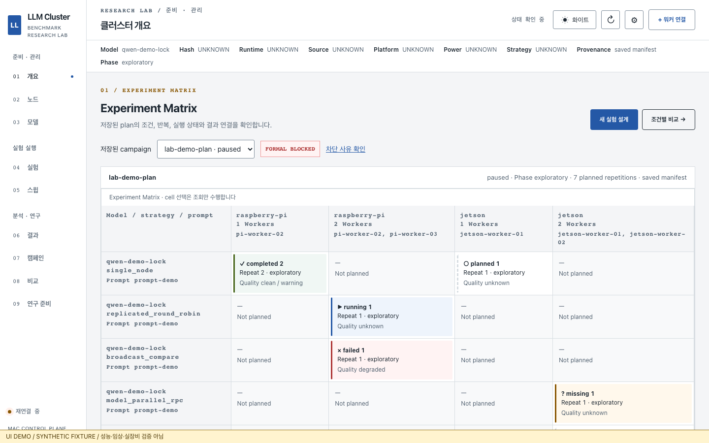
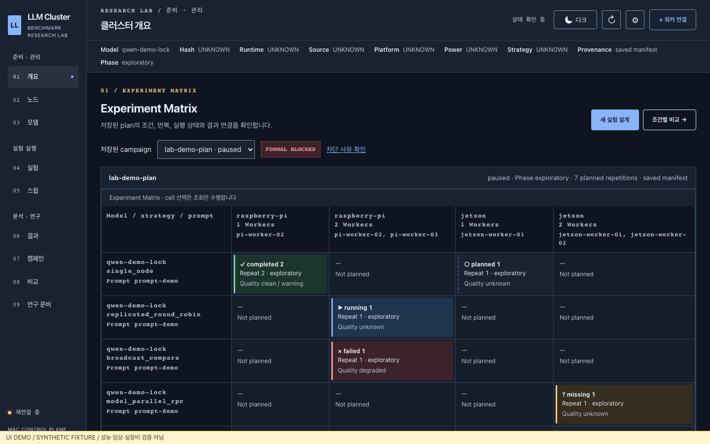

# 화이트·다크 모드 — 2026-10-07

## 사용법

대시보드 상단 ☀/☾ 버튼으로 전환합니다. 버튼의 `화이트` / `다크` 문구는 현재
모드를 표시합니다. 접근성 이름은 `다크 모드`, `aria-pressed=true`는 다크 모드입니다.

- 첫 방문은 운영체제의 `prefers-color-scheme`을 따릅니다. 직접 선택하기 전까지
  운영체제 화면 모드 변경도 반영합니다.
- 직접 선택한 모드는 브라우저 `localStorage`의 `llmClusterBenchmark.theme`에
  `light` 또는 `dark`로 저장합니다. 새로고침·재방문 및 같은 origin의 다른 탭에 반영합니다.
- 이 저장 키를 삭제하면 시스템 설정을 다시 따릅니다. 잘못된 값은 무시합니다.
  저장소가 차단된 브라우저에서도 현재 탭에서 전환할 수 있지만 영구 저장되지 않습니다.
- 첫 화면의 테마는 CSS 로드 전 적용합니다. 서버 설정/API에는 쓰지 않습니다.

## 구현과 상태 보존

`theme.js`가 root의 `data-theme`과 native control의 `color-scheme`을 변경합니다.
기존 CSS의 의미별 색상 토큰을 공유해 9개 hash 페이지, Matrix 셀, 상태·품질 배지,
선택·입력 필드, 스윕 화면, native dialog, 알림을 표시합니다.

화면의 canvas 그래프·빈 그래프·범례·Worker telemetry는 테마에 맞춰 다시 그립니다.
측정값과 원래 계열 색상 모델은 유지하며 화면에서만 가독성을 위한 색상으로 매핑합니다.
화이트 배경 PNG export와 논문용 SVG/PNG는 화면 테마와 독립적입니다.

페이지를 재생성하지 않으므로 입력, Worker·모델 선택, baseline, 비교 축·필터,
숨긴 계열, 스윕 preview 및 승인 hash가 유지됩니다. 실제 스윕 입력 변경은 기존대로
승인을 무효화합니다. 결과 export와 휴지통 보호, 비교 가능성 판정과 formal gate는
기존 기능을 사용합니다. 결측 전력을 0으로 치환하지 않습니다.

구현 커밋: `2426816`; 시각 검사 후 문구 대비·캡처 위치 보완: `5143b30`.

## 검증

최종 소스에서 `DASHBOARD_TEST_PORT=46177 npm test` 통과:

- JavaScript syntax, Dashboard export fixture, Research Lab 계산 fixture.
- Publication PNG fixture.
- **31 E2E**: 기존 24개 + 테마 7개. 시스템 기본값·설정 변경, 직접 선택 우선,
  새로고침 저장, 탭 간 동기화, invalid/blocked storage, 입력·baseline·계열 보존,
  빈 그래프 유지, 스윕 승인 보존 및 입력 변경 무효화, native dialog의 키보드
  focus 반환, 다크 화면의 흰 SVG export를 확인했습니다.
- 두 모드 × 9개 페이지에서 1440px/390px reflow와 대표 문구 4.5:1,
  대표 입력·버튼 경계 3:1 대비를 검사했습니다. CSS transition 종료 후 측정합니다.
  알림·결과 보조 문구도 포함했습니다.

로그: [theme-npm.log](logs/theme-npm.log). 테마 구현은 frontend 변경으로,
이 작업에서 Python 전체 720개를 재실행하지 않았습니다. 이전 리디자인의 Python
검증은 [VALIDATION.md](VALIDATION.md)에 기록되어 있습니다. 브라우저 자동 검증은
Chromium이며 Safari/Firefox 및 VoiceOver 실사용 검증은 별도로 수행하지 않았습니다.

## 실제 브라우저 캡처

[MANIFEST.json](captures/themes/MANIFEST.json)에 정확한 소스 커밋, 촬영 시각,
테마·viewport·hash·fixture 출처를 기록했습니다. 실제 Chromium으로 촬영한
**화면 PNG 18개 + 흰 배경 논문용 SVG/PNG 2개**입니다. Matrix, Compare, 스윕
blocker와 Worker dialog를 1440×900 / 390×844에서 촬영했습니다.
다크 모드에서 생성한 논문 PNG의 배경 픽셀도 `[255,255,255,255]`로 검사했습니다.

모든 데이터는 **synthetic fixture**이며 화면 하단에 표시했습니다. 장비 성능이나
연구 결과를 입증하는 캡처가 아닙니다. 정적 loopback 서버와 fixture만 사용하고,
fixture preview 외의 모든 실행·관리 요청은 거부합니다.

| 화이트 | 다크 |
|---|---|
|  |  |

재생성은 Dashboard 소스가 커밋된 상태에서 진행합니다:

```bash
node scripts/ui-redesign/capture-themes.js
```

## macOS 로컬 적용

기존 **http://127.0.0.1:8080/** 서비스에 적용했습니다. `./scripts/llm-cluster status`
정상이며 Controller의 `inference_enabled=false`를 확인했습니다. 기존 서비스가
템플릿·정적 자산을 직접 제공하므로 재시작 없이 적용했습니다.

- root HTML에 테마 버튼·초기 테마 script가 포함되어 있습니다.
- 제공되는 styles/sweeps CSS, app/theme JS는 최종 소스와 byte-for-byte 일치합니다.
- 실제 서비스에서 두 모드 각각 9개 페이지, 새로고침 저장, overflow를 확인했습니다.
  console/page 오류와 예상 밖 요청은 없었습니다.
- 이 확인에서는 모든 비-GET 및 외부 origin 요청을 차단했습니다. 서버 쓰기 0회.
  실제 데이터 캡처는 ignored `.artifacts/ui-deployment/`에만 보관했습니다.

기존 로컬 배포는 [DEPLOYMENT.md](DEPLOYMENT.md)에 기록되어 있습니다.
SSH 관리·모델 다운로드·실제 benchmark/campaign/sweep 실행·전력 변경은
수행하지 않았습니다. 기존 Controller의 읽기 전용 Worker 상태 polling은 유지됩니다.

테마만 되돌릴 때는 feature branch에서 `5143b30`, `2426816`을 최신 순서로 revert하고
브라우저를 새로고침합니다. inventory, settings, 결과·모델·lock은 변경하지 않습니다.
