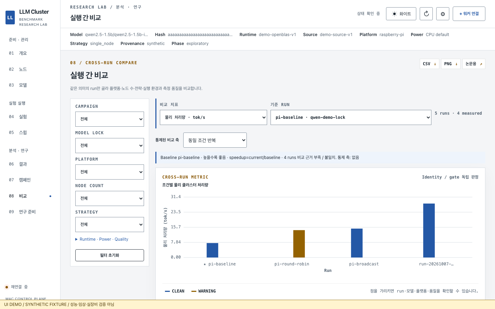
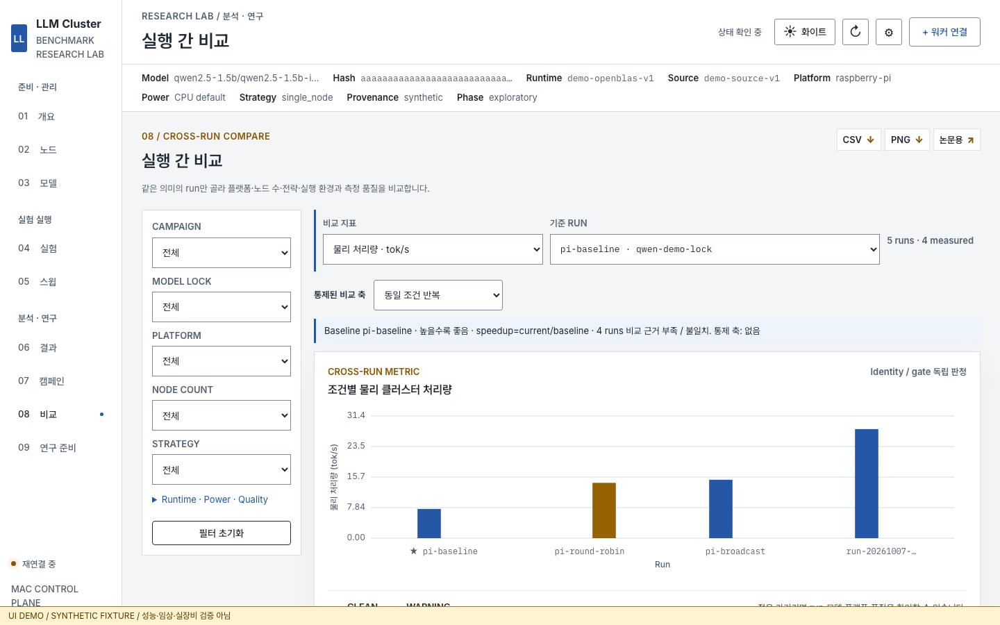
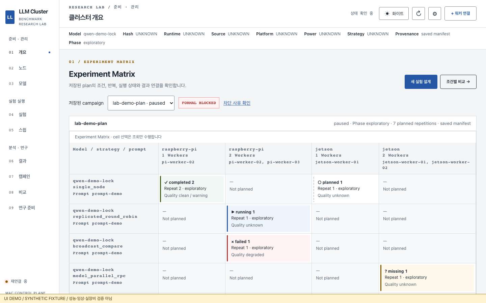
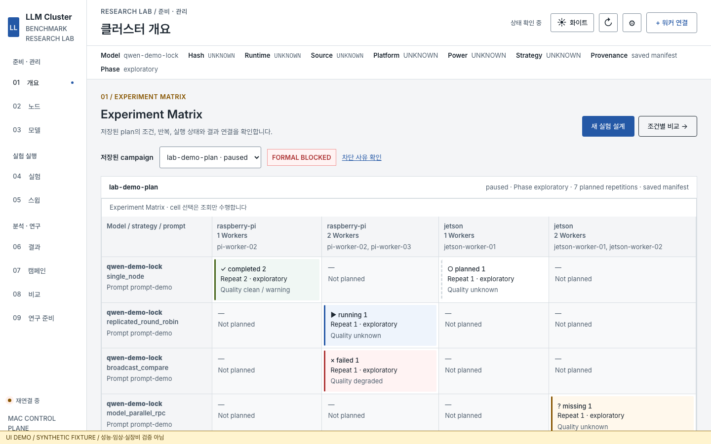

# Research Lab typography — 2026-10-07

## Scope and source

Repository `Phjrab/llm-cluster-benchmark`, branch `codex/ui-llm-cluster-research-lab`.
The starting tree was clean at `bbf3419`; implementation is `d72cd07`.
No applicable AGENTS.md exists in the repository or its parents. DESIGN_SPEC,
DECISIONS, INVENTORY and THEMES were reviewed before implementation.

This extends the current Research Lab UI. Colors, nine mounted hash pages,
Matrix/Compare organization, API contracts, units, formatting, rounding,
comparability, source/phase/quality/gate meaning and stored data are unchanged.
No reset, checkout, stash, push, service restart, operational deployment,
SSH/model/benchmark/campaign/power operations were used. Browser writes in tests
are synthetic handlers; capture fixtures reject execution and management.
The existing local service reads source assets directly; this is not a new deployment.

## Font source and registration

| Role/family | Official release | Registration | Asset size |
|---|---|---|---|
| Inter | 4.1 | normal variable 100–900; internal family `Inter Variable` | 352,240 B |
| Pretendard Variable | 1.3.9 | normal variable 45–920, matching official CSS | 2,057,688 B |
| IBM Plex Mono | IBM/plex repository tag 6.4.2 | static regular 400 | 45,640 B |

All assets are original WOFF2 files with SIL OFL 1.1 licenses retained individually.
Sources, exact download URLs, versions and SHA-256 are in
[font README](../../cluster/dashboard/static/fonts/README.md) and
[SHA256.json](../../cluster/dashboard/static/fonts/SHA256.json).
The full Pretendard variable asset is used, without invented character restrictions
or changed official subsets. `font-display: swap`; no CDN, local-font precedence,
or preload fan-out. Only normal UI and regular mono assets are bundled.

## Tokens and rules for future components

| Token | Stack | Use |
|---|---|---|
| `--font-ui` | Inter → Pretendard Variable → Pretendard → system sans | English/Korean UI, forms, buttons, status/quality/gate text |
| `--font-display` | `--font-ui` | Page and panel titles; no additional display face |
| `--font-numeric` | `--font-ui` | Throughput, latency, success, counts, repeats, baseline ratios |
| `--font-mono` | IBM Plex Mono → Pretendard Variable → Pretendard → system mono | Run ID, SHA, fingerprints, paths, config/code, raw/debug logs |
| compatibility | `--sans = --font-ui`, `--mono = --font-mono` | Existing modules |

- Body 14px/1.5; ordinary controls/buttons 14px, weight 400–500. Menu/header
  emphasis is 500–600; supporting labels are 13px. Tables/Matrix are 13px/1.5.
- Page titles 24–26px/600, panel/chart headings 16–18px/600. Technical text
  13px/400; `font-synthesis: none` prevents fabricated Plex bold/italic.
- Canvas axes are 12px, legends/tooltips 13px. SVG sweep axes render at 13px
  even on mobile, with local chart scrolling rather than scaling text down.
- Mixed Korean/English letter spacing is zero. Only short uppercase section
  labels use the small `.035em` tracking exception.
- `.numeric` and `.numeric-cell` use `lining-nums tabular-nums`. Numeric table
  cells/headers align right; evidence details inside numeric columns align left.
  Only selected hierarchy is emphasized, rather than every value being bold.
- Use `.identifier`/`code` for technical identities. Run IDs wrap and remain
  selectable; shortened SHA/runtime/source values have titles and the existing
  Compare condition details expose full, copyable values. Readiness SHA and
  observed Worker identities display complete values. Do not truncate warnings.
- Natural-language prompt/response text uses UI fonts, not technical mono.
  Korean logs fall back to Pretendard and must not be assumed fixed-width.
- Do not use `!important` or generic mono for numbers. Do not add wrapper spans
  around complete ordinary UI strings. Semantic identity/numeric roles are enough.

## Loaded paths and charts

HTML loads `/static/fonts/fonts.css` before `styles.css` and `sweeps.css`.
These are the only loaded Dashboard stylesheets. CSS role changes also reach
JS-generated models, nodes, results, sweeps, Matrix inspection and readiness.
The changed template assets carry `20261007.type` cache versions.

`app.js` Canvas now reads the role tokens through `chartFont()`, including empty
plots and Worker telemetry. Numeric axes use Inter; Run ID axis labels use Plex.
Text is measured with `ctx.measureText()`, including tick padding and available
label width. Long labels retain their full data in tooltips/linked table details.

`document.fonts.ready` and `loadingdone` schedule a presentation repaint, including
empty plots and open telemetry. Mounted form/filter/selection/approval state is
not regenerated. Dashboard PNG waits for font readiness before measuring/drawing.
SVG sweep labels use the role stacks, explicit readable coordinates and an
internal scrollbar. API/data/calculation code is not changed.

## Exports

| Path | Verified | Font policy / limitation |
|---|---|---|
| Dashboard Canvas PNG | Actual browser download and visual inspection | Local role stacks, unchanged image dimensions/header colors/data/units |
| Browser publication SVG | Actual download; academic family declaration preserved | Arial → Noto Sans CJK KR → Noto Sans KR → sans; 85mm rule preserved |
| Browser publication PNG | Actual download/inspection | Existing white surface, palette, axes and physical-size contract |
| Local publication PNG renderer | `render_publication_png.js`, synthetic SVG, 300/600dpi | 85mm gives 1004×709 / 2008×1418 pixels; DPI fixture gate passes |
| Python publication bundle | 11 existing unittest gates | Existing Arial/Helvetica SVG rules untouched; deterministic/no-imputation contracts pass |
| Other/server OS rendering | **Not verified** | No remote server contacted. Noto/Arial availability is host-dependent; font absence on that host must be checked before claiming Korean output |

CDP on the local standalone publication SVG reports Arial and Apple SD Gothic Neo.
The Dashboard's fonts are intentionally not injected into academic export.
Browser and local server renderer evidence does not establish identical rendering
on Linux, Safari, Firefox, or a different installed-font environment.

## Actual font evidence and samples

[Rendered fonts](captures/typography/after/rendered-fonts.json),
[font requests/FontFaceSet](captures/typography/after/font-loading.json),
[SVG font size](captures/typography/after/sweep-svg-fonts.json),
[late Canvas repaint](captures/typography/after/late-font-paints.json), and
[publication host fonts](captures/typography/after/publication-host-fonts.json).

`CSS.getPlatformFontsForNode` proves custom glyph usage:

- English UI, numeric specimen and actual metric cell: **Inter Variable**.
- `실험 조건 비교`: **Pretendard Variable** for Hangul, Inter for spaces.
- Actual Run ID, path and `0 O 1 I l`: **IBM Plex Mono**.
- Korean inside mono specimen/path: **Pretendard Variable**.
- SVG numeric axis: **Inter Variable**, measured screen size **13px**.

The test-only specimen also shows `측정 품질 · 실행 불가`,
`Benchmark Research Lab`, `Throughput / TTFT / E2E p95`,
`18.30 118.30 0.420`, `99.5% 1.83×` and a Korean model path.
Those numbers are typography samples, never stored or inserted as performance.
Actual DOM digit widths for 0/1/8 match within 0.05px under tabular figures.
The deliberately held WOFF2 requests prove that loading completion repaints
Canvas pixels while baseline, controlled axes and hidden series remain selected.

## Captures and validation

Before is the **current work's `bbf3419`**, served read-only by `git show`, never
old main. After uses committed Dashboard source `d72cd07`. Each viewport manifest
records source, fixture and zero live actions. Same `research-lab-v1` fixture and
same long identity/path are used for both stages.

Viewports: **1920×1080, 1440×900, 1280×800, 390×844**, plus 720×450 reflow as a
200% equivalent. Covers nine routes, Matrix, Compare plot/table/baseline, both
model views, node/model lists, experiment/sweep forms, readiness blocked gate,
Matrix/Worker dialogs, empty/error states, tooltip, full SHA/path details,
internal table scrolling, light/dark Compare and dashboard/publication exports.
Manual image inspection caught the narrow-screen Worker action labels splitting
vertically; header wrapping and non-shrinking actions now keep them readable.

Final validation details and logs are recorded below after the final capture run.

## Reproduce without hardware

```sh
# Current source: loopback static server + synthetic API handlers only
npm run test:typography
# Exact before source; reads committed blobs, never rewrites the checkout
TYPOGRAPHY_STAGE=before TYPOGRAPHY_SOURCE_REF=bbf3419 npm run test:typography
# Existing complete frontend/export regression gates, isolated runtime directory
DASHBOARD_TEST_PORT=46178 npm test
.venv/bin/python -m unittest cluster.tests.test_phase11_publication -q
```

All live actions are denied by the capture fixture. Font specimen code lives only
in tests. `typography.config.js` does not start the Controller. Actual runtime
results, auth details and local server-export scratch files remain ignored.

### Final gate results

| Gate | Result | Evidence |
|---|---|---|
| JavaScript syntax | Passed | npm regression log |
| Dashboard export / Research Lab metric fixtures | Passed | Existing zero/null/unit/comparability assertions retained |
| Publication PNG fixture | Passed | Existing dimensions and DPI assertions |
| Existing E2E | **31 passed** | [regression log](logs/typography-regression.log) |
| Final typography E2E | **8 passed** | [final log](logs/typography-final.log) |
| Before capture suite | **6 passed, 2 intentionally skipped** | [before log](logs/typography-before.log); no local-font contract in old source, and final host-export check is after-only |
| Python publication suite | **11 passed** | [unittest log](logs/typography-python-publication.log) |
| Local server publication PNG | **300 and 600dpi completed** | [renderer log](logs/typography-server-export.log) |
| `git diff --check` | Passed | Final source/document checks |

The complete npm run initially reported 38/39 because the test-only synthetic
sweep selection raced with initial sweep-list loading. Waiting for the initial
empty list fixed the fixture setup; the final eight-case typography suite passes.
An earlier overflow assertion also incorrectly required scrolling when a table
fit its available width; it now checks the scrolling contract plus actual overflow
at 720px. Vendor capture's initial DOM replacement race was fixed in the test.
These failures and fixes are disclosed, rather than counting the failed launches
as passing. There are **no remaining failed required checks**.

`pytest` is absent in the existing venv; the repository's native `unittest` path
ran successfully without installing packages. The full Python suite was not run
because no server/data code changed. Safari, Firefox, VoiceOver and remote/Linux
server font rendering were not run. Browser zoom was tested as 200% equivalent
reflow, not a native browser zoom setting.

### File inventory

- `cluster/dashboard/static/fonts/`: official WOFF2, licenses, registration,
  source README and checksums.
- `styles.css`, `sweeps.css`: role tokens, typography sizes/weights/spacing,
  numeric alignment, complete identity wrapping and narrow dialog fixes.
- `templates/index.html`: local font stylesheet and changed asset cache versions.
- `static/app.js`: Canvas roles/measurement/font repaint and Dashboard PNG readiness;
  semantic numeric/identity cells. Publication SVG generator left unchanged.
- `static/js/research.js`: semantic technical IDs, full identities in the existing
  comparison evidence details and tooltip full Run ID.
- `static/js/sweep-results.js`: semantic table roles and readable SVG coordinates.
- `cluster/tests/test_dashboard_exports.js`: version contract updates.
- `cluster/tests/e2e/typography.spec.js`: fixture captures, CDP, numeric alignment,
  delayed font repaint, scrolling/dialog checks and separate academic export check.
- `typography.config.js`, `scripts/ui-redesign/serve-typography.js`, `package.json`:
  reproducible static fixture-only capture gate and read-only before-source serving.
- `DESIGN_SPEC.md`, `DECISIONS.md`, this document, captures and logs: durable rules
  and evidence for future UI/chart work.

### Before / after

[Capture manifest](captures/typography/MANIFEST.json): **71 before / 74 after PNGs**
(including two server PNGs), plus one SVG per stage. All are synthetic.

| Before, current branch at bbf3419 | After, typography at d72cd07 |
|---|---|
|  |  |
|  |  |

Additional representative evidence: [specimen](captures/typography/after/specimen-1440.png),
[mobile Worker dialog](captures/typography/after/worker-modal-390.png),
[long Run ID](captures/typography/after/table-identities-1440.png),
[mobile SVG](captures/typography/after/sweep-svg-390.png),
[Dashboard PNG](captures/typography/after/dashboard.png),
[publication PNG](captures/typography/after/publication.png).
